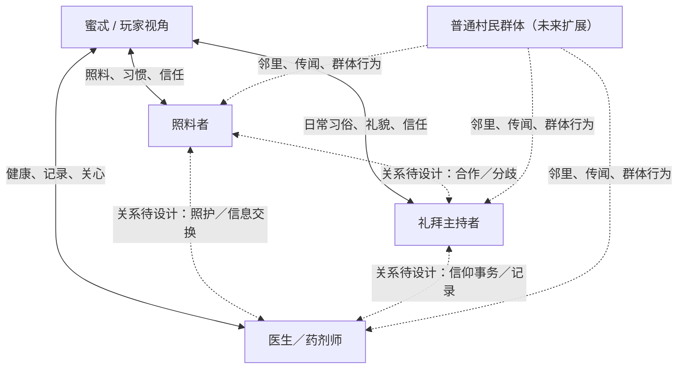

# 人物关系矩阵与 NPC 独立行为系统（设计基线）

> 状态：**系统方案已建立；具体人物关系仍有大量待讨论项。**  
> 范围：`Nereis Lullaby` development 分支。本文是实现约束，不将提案自动升级为世界观定稿。

## 1. 结论

现阶段**人物关系矩阵尚未完善**。当前已实现三名关键 NPC 的日程、蜜忒对三人的关系数值，以及三段一次性个人日常片段；但尚无完整的 NPC-NPC 关系、个人目标、记忆、知识边界、压力反应和相互影响行为。

设计目标不是给每个村民接入复杂的通用 AI，而是建立一个**确定性、可测试、由角色动机驱动的轻量社会模拟**：角色即使玩家不在场也有自己的生活；角色的行动可以自然地产生剧情条件和线索，但不应每个动作都像为玩家安排的任务。

## 2. 关系图（原型范围）



实线只表达原型已呈现的蜜忒—NPC 接触类型，不表示完整关系已定稿；虚线明确表示 NPC 之间的关系仍是待设计空间。

## 3. 关系矩阵（当前已知与待设计分开）

| 关系对 | 当前原型可确认的内容 | 待补齐的维度 |
|---|---|---|
| 蜜忒 ↔ 照料者 | 照料者照顾蜜忒；有旧布袋与童年习惯片段（原型文本） | 双向信任、分歧边界、彼此记忆、压力下的选择 |
| 蜜忒 ↔ 礼拜主持者 | 有礼拜场所日常接触；一起整理布带（原型文本） | 私人情感与公共职责的冲突、信仰认知、对蜜忒的保护动机 |
| 蜜忒 ↔ 医生 | 诊疗处接触、睡眠相关话题、整理标签（原型文本） | 医疗伦理、信息保密、观察习惯、风险判断 |
| 照料者 ↔ 礼拜主持者 | 尚无已确认的具体关系 | 是否互相信任、对传统的理解是否一致、是否有旧分歧 |
| 照料者 ↔ 医生 | 尚无已确认的具体关系 | 是否交换健康信息、照护责任如何分工、隐私边界 |
| 礼拜主持者 ↔ 医生 | 尚无已确认的具体关系 | 是否共同处理村庄事务、对异常现象的解释差异 |
| 关键 NPC ↔ 普通村民 | 世界观允许村民有各自日常与群体行为 | 邻里网络、传闻传播、集体活动与个体异议 |

不要为了填满表格而虚构关系。NPC-NPC 关系可先使用“熟识程度、信任、职责合作、未解决分歧”四个独立维度；具体角色关系在剧情设计有证据时再落地。

## 4. 每个关键 NPC 的行为卡

每位关键 NPC 都需要一份可数据化的行为卡：

- **身份与日常职责**：职业、日程、常去地点。
- **短期目标**：当前时段希望完成的具体事情。
- **长期动机**：维持日常、保护某人、履行职责等；不自动等于隐藏阴谋。
- **价值优先级**：遇到冲突时先保什么、后放弃什么。
- **关系状态**：对蜜忒及其他重要角色的信任、亲近、合作、怨怼。
- **记忆**：只记住自己亲历、听说或有合理渠道获知的事件。
- **知识边界**：亲眼所见、可靠听闻、猜测、误解、未知必须分开。
- **压力反应**：回避、安抚、追问、隐瞒、求助等个体化反应。
- **剧情触发器**：何种事实会改变计划、对话或关系。
- **行动后果**：行动改变了什么状态，谁能观察到，哪些线索可被玩家发现。

关键原则：角色不是“知道剧情脚本”，而是根据自己的经历、目标、关系与误解作出有限选择。

## 5. NPC 行为架构

采用四层，而不是让一个大脚本同时管理所有事情：

1. **日程层（Schedule）**：决定正常情况下某个日期/时段通常在哪里。
2. **动机层（Goal/Utility）**：根据目标、需求、关系和已知事实，选取当前优先行动。
3. **事件覆盖层（Authored Event Override）**：重要剧情可暂时覆盖日程，但必须有开始条件、持续时间、优先级与结束/恢复规则。
4. **记忆与因果层（Memory/Consequences）**：记录角色亲历的事件，并更新关系、目标、后续对白或可观察线索。

建议的单次更新流程：

```
时间推进 / 玩家行动 / 剧情事件
            ↓
收集角色可访问的事实与记忆
            ↓
评估日程、当前目标、关系和压力
            ↓
选择一个合法行动（含“不行动/回避”）
            ↓
执行行动并产生显式状态变化
            ↓
向有合理信息渠道的角色传播消息
            ↓
更新可见反馈、线索与后续事件条件
```

原型阶段不需要每帧实时模拟。只在时段推进、玩家完成行动或剧情事件发生时进行离散更新；结果必须可复现、可测试、可从存档恢复。

## 6. 关键人物与普通 NPC 分级

| 等级 | 对象 | 行为模型 | 目标 |
|---|---|---|---|
| Tier 1：剧情角色 | 蜜忒、Hero（仅作为跨项目世界观参考）、未来重要人物 | 独立目标、记忆、知识边界、关系、压力反应、事件专属行为 | 承担主要因果和人物弧线 |
| Tier 2：关键村民 | 当前照料者、礼拜主持者、医生 | 日程 + 目标优先级 + 关系/记忆 + 少量可中断行为 | 自主推进村庄生活并生成线索 |
| Tier 3：具名普通 NPC | 未来新增居民、商贩、邻居等 | 日程模板 + 一两个目标 + 与少数角色的关系 + 事件记忆摘要 | 形成可信的社会网络、局部支线 |
| Tier 4：群体/背景居民 | 不重要的路人、集体活动人群 | 群体状态、地点分布、活动阶段；不要求每人有完整个人 AI | 呈现村庄整体变化且成本可控 |

普通 NPC 不是“没有逻辑”，而是采用低成本、可解释的逻辑。只有进入剧情焦点、被玩家接触或影响关键事件时，才升级为更细的个体模拟。

## 7. 关系不是单一好感度

建议每个重要关系采用独立维度，原型先不显示为数字：

- **亲近 / Affinity**：愿不愿意花时间陪伴。
- **信任 / Trust**：是否相信对方说的话、是否愿意托付事情。
- **合作 / Cooperation**：在共同任务或危机中是否愿意配合。
- **紧张 / Tension**：未解决分歧、恐惧或压力。
- **认知 / Knowledge**：不是关系分数；单独保存彼此知道什么。

不能把这些维度简单相加成一个“好感值”。高亲近不代表高信任；高信任也不代表对方会同意所有请求。关系应通过可观察行为体现，例如主动帮忙、改变计划、回避话题、替人保留物品，而不是只弹出 +1。

## 8. 信息传播与剧情共同推进

任何 NPC 获知事件必须有来源：

- 亲眼见到；
- 当事人告诉；
- 可信第三方转述；
- 从物件、记录或现场推断；
- 不可靠传闻（应保留错误可能）。

不要把玩家的线索簿自动同步到全体 NPC。也不要让某人因为另一个地点发生了事件就无条件知情。

NPC 之间可以通过日常行为共同推进剧情，例如：
- 医生因近期工作量改变日程，照料者察觉疲惫后提供帮助；
- 礼拜主持者临时借用公共空间，其他居民因此改变当天安排；
- 两人对同一件普通小事作出不同解释，玩家通过先后拜访发现矛盾。

以上是行为系统示例，不是已确定剧情。

## 9. 设计护栏

- 主要剧情应由多个可理解的原因共同推动，而非单个隐藏数值自动触发。
- NPC 可以误解、隐瞒或不知道；但叙事因果必须一致。
- 蜜忒的纯真与善意是真实的，不应因隐藏系统而变成有意识操纵村民。
- 村民对蜜忒的保护倾向不等于他们知道她是外神代理，也不等于全村拥有同一意识。
- 重要线索允许错过现场，但应有后续痕迹；避免单次错过导致主线软锁。
- 关系状态、调查进度和世界状态分别存储，通过显式事件条件连接。
- 不需要给背景路人创建复杂 LLM/规划器；采用数据驱动的有限状态/效用评分即可。

## 10. 实施路线

1. **设计基线（本文件）**：列出已知关系、未知关系和行为合同。
2. **角色数据化**：为三名关键 NPC 添加目标、动机、知识边界、关系维度与压力反应数据。
3. **事件/记忆合同**：明确“谁做了什么、谁知道了什么、哪些状态被改变”。
4. **离散行为模拟器**：在时段推进和玩家行动后评估行为，不做每帧 AI。
5. **可见反馈**：用位置、对白、物件状态、缺席与回访变化呈现行为结果。
6. **普通 NPC 扩展**：先加少量有关系联系的居民，再考虑群体模拟。
7. **回归测试**：验证知识泄漏、日程覆盖、事件重复触发、存档恢复和错过内容后的替代证据。

当前状态：**设计方案已写入；关系事实仍有待设计；行为模拟器尚未实现；Godot 引擎测试尚未进行。**
