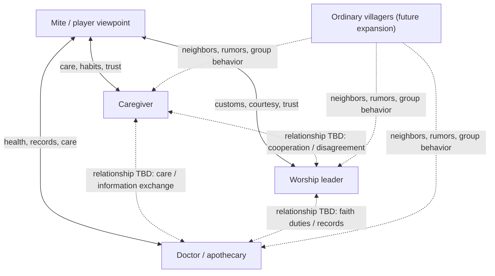

# Character Relationship Matrix and Independent NPC Behavior

> Status: **The system proposal is established; many specific character relationships remain open.**  
> Scope: the `Nereis Lullaby` development branch. This document constrains implementation; proposals are not automatically canon.

## 1. Verdict

The relationship matrix is **not yet complete**. The prototype currently has schedules for three key NPCs, relationship values between Mite and each of them, and three one-time everyday character moments. It does not yet implement a full NPC-to-NPC relationship network, personal goals, memory, knowledge boundaries, stress responses, or consequential behavior between characters.

The goal is not to give every villager an expensive general-purpose AI. Build a **deterministic, testable, lightweight social simulation driven by character motives**. Characters should continue living when the player is elsewhere, and their actions may naturally create story conditions and clues without making every action feel like a quest arranged for the player.

## 2. Relationship graph (prototype scope)



Solid edges describe contact types currently presented in the prototype; they do not mean the full relationships are finalized. Dashed edges explicitly mark open design space between NPCs.

## 3. Relationship matrix (known facts vs. open design)

| Pair | What the current prototype supports | What remains to design |
|---|---|---|
| Mite ↔ Caregiver | The caregiver looks after Mite; an old herb pouch/childhood-habit scene exists as prototype text | Mutual trust, disagreement boundaries, shared memories, choices under pressure |
| Mite ↔ Worship leader | Everyday contact at the shrine; they retie a ribbon in prototype text | Personal feeling vs. public duty, faith knowledge, reasons to protect Mite |
| Mite ↔ Doctor | Clinic contact, sleep-related talk, and a label-sorting scene | Medical ethics, confidentiality, observational habits, risk assessment |
| Caregiver ↔ Worship leader | No specific relationship confirmed | Trust, differing interpretations of tradition, past disagreements |
| Caregiver ↔ Doctor | No specific relationship confirmed | Health-information exchange, division of care, privacy boundaries |
| Worship leader ↔ Doctor | No specific relationship confirmed | Shared village duties, differing explanations of unusual events |
| Key NPCs ↔ ordinary villagers | The world permits individual routines and group behavior | Neighbor networks, rumor propagation, communal events, individual dissent |

Do not invent relationships just to fill every cell. NPC-to-NPC relationships can initially use four independent dimensions: familiarity, trust, duty-based cooperation, and unresolved tension. Populate specific character ties only when supported by story design.

## 4. Behavior card for each key NPC

Each key NPC needs a data-driven behavior card:

- **Identity and daily role**: occupation, schedule, usual locations.
- **Short-term goal**: a concrete thing they want to accomplish this period.
- **Long-term motive**: maintain routine, protect someone, fulfill a duty, etc.; this does not automatically imply a hidden conspiracy.
- **Value priorities**: what they preserve first and what they sacrifice when goals conflict.
- **Relationships**: trust, affinity, cooperation, resentment toward Mite and other important characters.
- **Memory**: remember events personally witnessed, heard from a source, or learned through a plausible channel.
- **Knowledge boundaries**: separate witnessed facts, reliable reports, guesses, misunderstandings, and unknowns.
- **Stress response**: individualized avoidance, reassurance, questioning, concealment, help-seeking, and so on.
- **Story triggers**: facts that can change plans, dialogue, or relationships.
- **Action consequences**: what state changes, who can observe it, and which evidence the player may discover.

Core rule: a character does not “know the script.” They make limited choices based on experience, goals, relationships, and misunderstandings.

## 5. NPC behavior architecture

Use four layers instead of one monolithic script:

1. **Schedule**: where a character normally is at a given day/period.
2. **Goal/utility**: choose a current priority from goals, needs, relationships, and known facts.
3. **Authored-event override**: major scenes may temporarily override schedules, but must define preconditions, duration, priority, and recovery/exit rules.
4. **Memory and consequences**: record witnessed events and update relationships, goals, later dialogue, or discoverable evidence.

Suggested update flow:

```
Time advance / player action / authored event
                    ↓
Collect facts and memories available to this character
                    ↓
Evaluate schedule, current goal, relationships, and stress
                    ↓
Choose one legal action (including doing nothing / avoiding)
                    ↓
Execute action and emit explicit state changes
                    ↓
Share information only through plausible channels
                    ↓
Update visible feedback, clues, and future event conditions
```

The prototype does not need frame-by-frame simulation. Update discretely when time advances, the player completes an action, or a story event occurs. Results must be reproducible, testable, and save/load-safe.

## 6. Separate simulation tiers

| Tier | Actors | Behavior model | Purpose |
|---|---|---|---|
| Tier 1: narrative characters | Mite, Hero as cross-project reference only, future major characters | Independent goals, memory, knowledge boundaries, relationships, stress responses, bespoke event behavior | Carry major causality and character arcs |
| Tier 2: key villagers | Current caregiver, worship leader, doctor | Schedule + goal priority + relationships/memory + a few interruptible behaviors | Autonomously advance village life and produce clues |
| Tier 3: named ordinary NPCs | Future residents, merchants, neighbors | Schedule template + one or two goals + a few social ties + summarized event memory | Create a credible social network and local side stories |
| Tier 4: background/group residents | Unimportant passersby and crowds | Group state, location distribution, activity phase; no full personal AI required | Show village-wide changes at controlled cost |

Ordinary NPCs are not “illogical”; they use lower-cost, explainable logic. Simulate an individual in greater detail only when they enter the narrative focus, are contacted by the player, or affect a key event.

## 7. Relationships are not one affection score

Use independent dimensions for important relationships, initially hidden from the player:

- **Affinity**: willingness to spend time together.
- **Trust**: willingness to believe or confide in someone.
- **Cooperation**: willingness to work together during a task or crisis.
- **Tension**: unresolved disagreement, fear, or pressure.
- **Knowledge**: not a relationship score; store separately what each person knows.

Do not add these into one “affection” number. High affinity does not imply high trust, and trust does not mean automatic agreement. Show relationships through observable behavior—helping, changing plans, avoiding a topic, keeping an item safe—instead of only displaying +1.

## 8. Information flow and shared story causality

Every NPC learning an event needs a source:

- witnessed it directly;
- was told by a participant;
- heard it from a credible third party;
- inferred it from an object, record, or location;
- heard an unreliable rumor, which must retain the possibility of error.

Never synchronize the player's clue journal automatically to every NPC. A character must not know what happened elsewhere without a plausible information channel.

NPCs can jointly advance a story through ordinary behavior, for example:
- A doctor's increased workload changes his schedule; the caregiver notices his fatigue and offers help.
- The worship leader temporarily borrows a shared space, changing other residents' plans.
- Two characters explain the same ordinary event differently, allowing the player to discover a contradiction by visiting them at different times.

These are behavior-system examples, not finalized plot.

## 9. Design guardrails

- Major story beats should emerge from multiple understandable causes, not one hidden meter.
- NPCs may misunderstand, conceal, or remain ignorant, but causality must remain coherent.
- Mite's innocence and kindness are genuine; hidden systems must not turn her into a conscious manipulator of villagers.
- Villagers' protective instincts do not mean they know Mite is an outer-god agent or share one collective consciousness.
- Important clues may be missed in the moment, but aftermath should preserve traceable evidence where possible.
- Store relationships, investigation progress, and world state separately; connect them through explicit event conditions.
- Do not create complex LLM/planner AI for background extras; use data-driven finite states or utility scoring.

## 10. Implementation roadmap

1. **Design baseline (this document)**: list known relationships, open ties, and behavior contracts.
2. **Data-driven character profiles**: add goals, motives, knowledge boundaries, relationship dimensions, and stress responses for the three key NPCs.
3. **Event/memory contract**: define who did what, who learned what, and which states changed.
4. **Discrete behavior simulator**: evaluate behavior on time advances and player actions, not every frame.
5. **Visible feedback**: express behavior through location, dialogue, object state, absence, and revisits.
6. **Ordinary NPC expansion**: add a few socially connected residents before considering group simulation.
7. **Regression tests**: cover knowledge leaks, schedule overrides, duplicate events, save/load, and alternate evidence after missed scenes.

Current status: **design proposal written; specific relationship facts remain open; behavior simulator not implemented; Godot runtime tests not run.**
